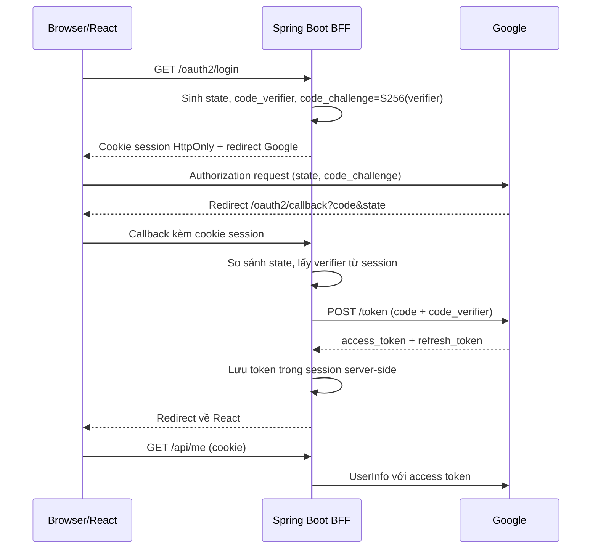
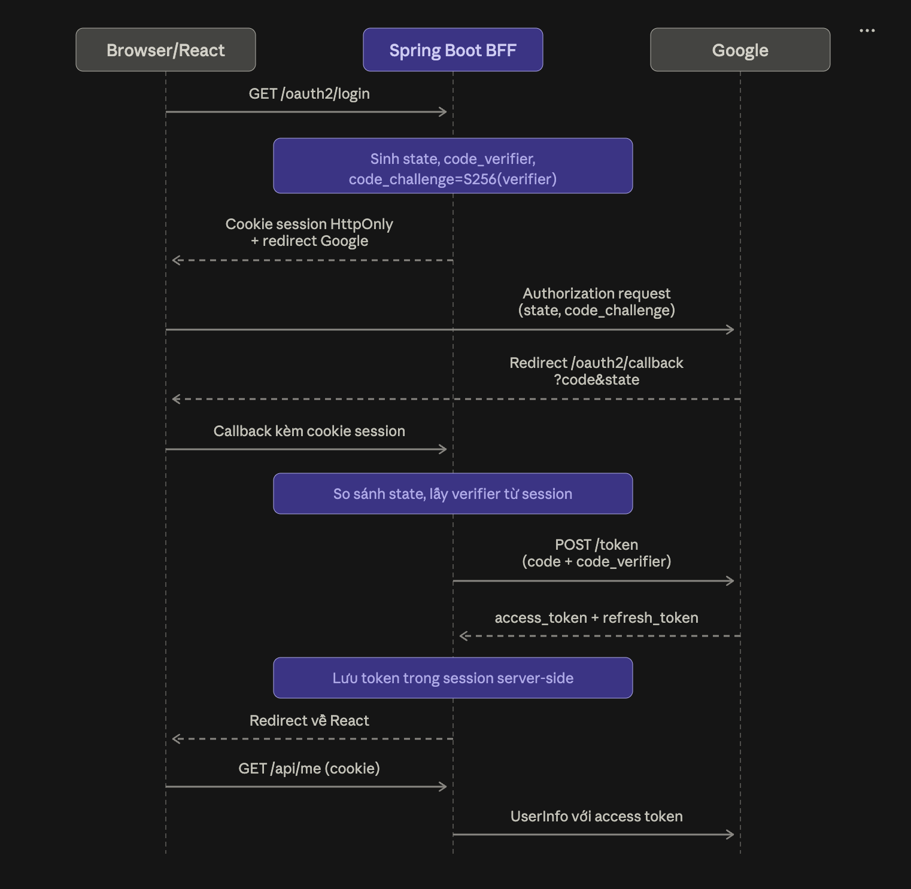

# OAuth 2.0 Authorization Code + PKCE với Google

Mẫu này dùng React SPA và Spring Boot làm **backend-for-frontend (BFF)**. Backend sinh
`state`, `code_verifier`, lưu chúng trong session server-side, rồi gửi `code_challenge`
`S256` tới Google. Google callback về backend; backend đổi `code` lấy token và giữ
access/refresh token trong session. Browser chỉ giữ cookie session `HttpOnly`.

## Luồng




## Chạy local

1. Tạo OAuth Client ID loại **Web application** trong Google Cloud Console.
2. Thêm chính xác redirect URI:
   `http://localhost:8080/oauth2/callback`
3. Bật scope OpenID/Google user info nếu project yêu cầu.
4. Chạy backend:

```bash
export GOOGLE_CLIENT_ID='...apps.googleusercontent.com'
export GOOGLE_CLIENT_SECRET='...'
cd backend
mvn spring-boot:run
```

5. Chạy frontend ở terminal khác:

```bash
cd frontend
npm install
npm run dev
```

Mở `http://localhost:5173`, bấm đăng nhập và kiểm tra:

- callback trả về `http://localhost:5173`;
- `GET /api/me` trả thông tin Google;
- nút đăng xuất gọi `POST /api/logout`.

## Lưu ý bảo mật

- Không lưu access/refresh token trong `localStorage`, `sessionStorage` hoặc URL.
  Mẫu lưu token trong `SessionStore` để đơn giản; production dùng Redis/database có
  TTL, mã hóa at-rest và cơ chế session rotation.
- Luôn kiểm tra `state` bằng so sánh constant-time và ràng buộc với đúng session bắt
  đầu đăng nhập. Không chấp nhận `redirect_uri` tùy ý từ query string.
- `redirect_uri` phải khớp tuyệt đối với Google Console; production dùng HTTPS và
  cookie `Secure`, `HttpOnly`, `SameSite=Lax/Strict`.
- Không log authorization code, verifier hoặc token. Giới hạn CORS, thêm CSRF protection
  cho các request thay đổi trạng thái, và validate issuer/audience/nonce nếu tự xử lý
  ID token.
- Refresh token không phải lúc nào cũng được Google gửi lại. Không ghi đè refresh token
  cũ bằng giá trị `null` khi refresh token rotation.
- Mẫu in-memory sẽ mất phiên khi restart và không dùng được khi chạy nhiều instance.
- `client_secret` không được đưa vào SPA; trong mô hình BFF, secret chỉ ở backend.
